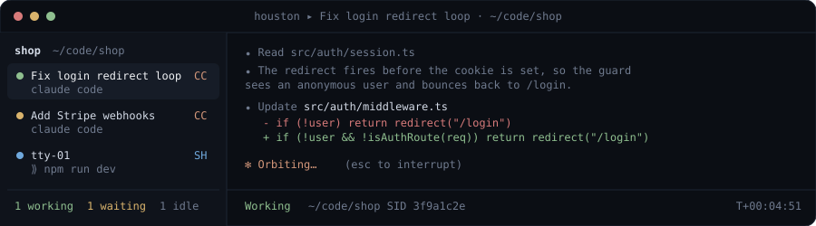

<p align="center">
  
</p>

<p align="center">
  
  
  
  
  
</p>

```text
 DWG HSTN-01 ─────────────────────────────────────────── REV D
   ◯  HOUSTON, WE HAVE 6 AGENTS IN FLIGHT · 1 AWAITING GO
```

**Houston** is mission control for your [Claude Code](https://claude.com/claude-code) fleet. It's a native macOS
app where every agent and shell gets its own terminal, grouped by project, each with a live status light
and a callsign taken from whatever it's working on.

Launch a few agents with a brief, let them fly, and stop babysitting tabs. Houston keeps an eye on the
telemetry and calls you back when an agent lands or needs a decision.

<p align="center">
  
</p>

## Flight systems

| System | |
|---|---|
| **Projects & sessions** | Add project folders, then launch Claude Code agents and shells inside them. Everything is restored after a restart. |
| **Self-naming agents** | New agents name themselves after the topic Claude Code puts in the terminal title (`✳ Fix login redirect loop`). Double-click to rename. Your name sticks. |
| **Live telemetry** | Each session shows a status light: launching, working, waiting for you, or idle. The sidebar counts how many are working and waiting. |
| **Attention signals** | If work finishes while you're looking elsewhere, you get a macOS notification and a dock badge with the number of waiting sessions. |
| **Resumable conversations** | Every agent has a fixed Claude Code session id, so closing Houston never loses a conversation. It resumes where it stopped. |
| **Plan limits** | Houston routes Claude Code's statusline through a tiny script and shows how much of your 5-hour and weekly limits is left. |
| **Warp-style shell input** | zsh sessions get a command editor with syntax highlighting, history ghost text, `Tab` completion (commands, paths, git refs, npm scripts) and `⌃R` search. |
| **Focus, grid & split** | Look at one pane at a time, all of them in a grid (or just one project's: the grid button or "Open in grid" on the project), or two side by side. Drag the gaps to resize panes and the sidebar edge to resize the sidebar (double-click resets), drag sidebar rows or grid pane headers to reorder (or a sidebar row onto a split pane to show it there), and collapse grid panes into a dock below with the collapse button (click a chip to restore). |
| **Mission briefs** | `⌘N` asks for an opening prompt, so a new agent starts working (and is named) right away. |
| **Waiting previews** | A waiting agent shows its last question or message in the sidebar and in the notification. |
| **Session usage** | Each Claude session shows its cost and context use, taken from Claude Code's statusline. |
| **Changes** | Projects with uncommitted work show a `+2 ~5 ?1` badge; click it (or `⌘D`) for a file-by-file diff. |
| **Find & palette** | `⌘F` searches a terminal's scrollback; `⌘P` jumps to any session, project action or command. |
| **Alias launchpad** | `⌘⇧P` lists the aliases in your `.zshrc`. Pick one to open it in a fresh shell (handy for `ssh` hops), or add, edit and delete aliases without leaving the app. |
| **Mission patches** | Each project gets its own colour, used in the sidebar, the pane header, the diff panel and the palette. Fold projects you're not working on. |
| **Project actions** | Right-click a project to open it in your editor or Finder, run an npm script, or open a pull request. |

<p align="center">
  
</p>

Every status light is Houston's mark at 16px: a ring with one satellite. Colour, the satellite's position and its
motion each say the state on their own, and the centre says the kind of session: a coral spark for Claude
agents, an ink prompt for shells.

## Controls

| Keys | Action | | Keys | Action |
|---|---|---|---|---|
| `⌘O` | add project | | `⌘G` | toggle grid / focus |
| `⌘N` | new Claude agent (with brief) | | `⌘\` | toggle split view |
| `⌘T` | new shell | | `⌘1`–`⌘9` | jump to session |
| `⌘W` | close session | | `⌘[` / `⌘]` | previous / next session |
| `⌘R` / `⏎` | relaunch an exited session | | `⌘K` | clear terminal |
| `⌘J` | next waiting session | | `⇧⏎` | newline in Claude's prompt |
| `⌘⇧R` | rename session | | `⌘B` | toggle sidebar |
| `⌘P` | command palette | | `⌘F` | find in terminal |
| `⌘⇧P` | aliases | | `⌘D` | show uncommitted changes |

## Launch sequence

Grab the latest `.dmg` from [Releases](https://github.com/janoschjost/houston/releases), or build it yourself:

```text
T-3  ▸ prerequisites   macOS · Node 18+ · Rust (stable) · Claude Code CLI on your PATH
T-2  ▸ fuel up         npm install
T-1  ▸ ignition        npm run tauri dev
T-0  ▸ liftoff         npm run tauri build   →  src-tauri/target/release/bundle/{macos,dmg}/
```

To cut a release, run `scripts/release.sh 0.2.0`. It bumps the version, tags and pushes, and the
[release workflow](.github/workflows/release.yml) builds a universal `.dmg` into a draft GitHub release.
Builds are signed and notarized when the Apple secrets are set, and unsigned otherwise.

## Under the hood

```
 ┌──────────────────────── Houston.app ────────────────────────┐
 │  src/          TypeScript UI (Vite, xterm.js + WebGL)       │
 │   ├ app.ts       sidebar, layout, shortcuts, persistence    │
 │   ├ session.ts   one pane: PTY, status tracking, naming     │
 │   ├ input.ts     Warp-style command editor + completion     │
 │   ├ palette.ts   command palette and mission briefs         │
 │   ├ icons.ts     the mark, status lights and line icons     │
 │   ├ aliases.ts   .zshrc alias launchpad                     │
 │   └ diff.ts      uncommitted changes panel                  │
 │                         ▲  Tauri IPC  ▼                     │
 │  src-tauri/    Rust backend                                 │
 │   ├ pty.rs       spawns and streams pseudo-terminals        │
 │   ├ shell.rs     zsh integration (OSC 6973), git, state     │
 │   ├ aliases.rs   reads and edits aliases in .zshrc          │
 │   └ limits.rs    statusline capture for limits and usage    │
 └─────────────────────────────────────────────────────────────┘
```

- Claude sessions run `claude --session-id <uuid>` (later `--resume <uuid>`) in your interactive login shell,
  so `PATH` and environment match your normal terminal.
- Shell sessions load your own zsh config through a wrapper `ZDOTDIR`, which adds hooks that report prompt,
  command and directory changes to Houston.
- Session state is stored in Houston's app data directory and written atomically.
- The look lives in two places: colour, type and motion tokens at the top of `src/style.css`, and the mark,
  status lights and icons in `src/icons.ts`. The app icon is drawn from the same mark in
  `src-tauri/icons/icon.svg`. Every animation runs on one 2.4 s period, half of it or a multiple of it.

<p align="center"><sub>GROUND CONTROL TO MAJOR AGENT &nbsp;·&nbsp; DWG HSTN-README &nbsp;·&nbsp; REV D</sub></p>
